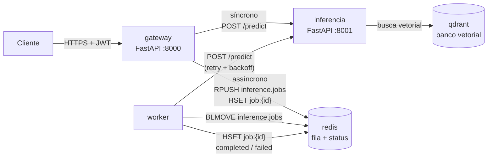

# Plataforma de IA como Serviço (C3.A2)

**Sistemas Distribuídos e Computação em Nuvem · FAESA · 2026/2** · Prof. Howard Cruz Roatti

Plataforma cloud-native em microsserviços que recebe textos por uma API segura, processa de forma
síncrona ou assíncrona (fila) e devolve uma predição com documentos de contexto recuperados de um
banco vetorial.

## 🌐 URL pública (HTTPS)

| O quê | Endereço |
|---|---|
| Saúde do sistema | https://sd-2026-2-kit-c3a2-production.up.railway.app/health |
| Documentação interativa (Swagger) | https://sd-2026-2-kit-c3a2-production.up.railway.app/docs |

Hospedado no **Railway** (free trial). Só o **gateway** tem endereço público; os demais serviços ficam
na rede privada do Railway (`*.railway.internal`). O certificado HTTPS é emitido pelo próprio Railway.
Todo push na branch `main` gera um novo deploy automaticamente.

---

## 🏗️ Arquitetura



| Serviço | Pasta | Responsabilidade | Etapa |
|---|---|---|---|
| **gateway** | `gateway/` | Única porta de entrada: JWT, rate limit, roteamento síncrono/assíncrono, logs sem dados pessoais | 1 |
| **inferencia** | `inferencia/` | Modelo scikit-learn (sentimento), embeddings locais, busca no Qdrant, LLM opcional | 2 |
| **qdrant** | imagem oficial | Armazenamento vetorial dos documentos | 2 |
| **redis** | imagem oficial | Fila de jobs (`inference.jobs`), fila de erro (`inference.dlq`) e status com TTL | 3 |
| **worker** | `worker/` | Consome a fila, chama a inferência com retentativa e grava o resultado | 3 |

**Comunicação:**
- **Síncrona (REST):** `POST /v1/infer` → gateway chama `inferencia/predict` e devolve na hora.
- **Assíncrona (fila):** `POST /v1/jobs` → responde `202` com `job_id`; o worker processa e o cliente
  consulta `GET /v1/jobs/{job_id}` até `completed` ou `failed`.
- **Descoberta de serviços:** sempre pelo **nome** (`redis`, `qdrant`, `inferencia`), nunca por IP.

Contrato da fila: [`docs/etapa3-contrato.md`](docs/etapa3-contrato.md) ·
Detalhes de cada serviço: [`gateway/README.md`](gateway/README.md),
[`inferencia/README.md`](inferencia/README.md), [`worker/README.md`](worker/README.md) ·
Trade-offs: [`docs/tradeoffs.md`](docs/tradeoffs.md)

---

## ▶️ Como rodar do zero (um comando)

Pré-requisito: Docker com Docker Compose.

```bash
git clone https://github.com/bernardomerlo/sd-2026-2-kit-c3a2.git
cd sd-2026-2-kit-c3a2
cp .env.example .env          # troque o JWT_SECRET antes de usar fora do seu PC
docker compose up --build
```

Sobem 5 containers: `redis`, `qdrant`, `inferencia`, `worker` e `gateway`.
O gateway fica em **http://localhost:8000** (Swagger em http://localhost:8000/docs).
Funciona **100% offline**: o modelo é treinado no build e o LLM roda em modo simulado sem `LLM_API_KEY`.

Para parar e apagar os dados: `docker compose down -v`.

**Deploy em VM própria (opcional):** `docker compose -f docker-compose.yml -f docker-compose.prod.yml up --build -d`
coloca o **Caddy** na frente do gateway, com HTTPS automático (Let's Encrypt) para o domínio em `DOMAIN` no `.env`.

---

## 🧪 Como testar

Troque `URL` por `http://localhost:8000` (local) ou pela URL pública.

```bash
URL=https://sd-2026-2-kit-c3a2-production.up.railway.app

# 1. Saúde: gateway, inferência e Redis
curl $URL/health

# 2. Sem token -> 401
curl -i -X POST $URL/v1/jobs -H "Content-Type: application/json" -d '{"texto":"teste"}'

# 2b. Rate limit: passando de 60 requisições/minuto o gateway responde 429 (Retry-After)

# 3. Gerar token JWT
TOKEN=$(curl -s -X POST $URL/auth/token -H "Content-Type: application/json" \
  -d '{"username":"avaliador"}' | python -c "import sys,json;print(json.load(sys.stdin)['access_token'])")

# 4. Inferência síncrona
curl -X POST $URL/v1/infer -H "Authorization: Bearer $TOKEN" -H "Content-Type: application/json" \
  -d '{"texto":"o que é circuit breaker?"}'

# 5. Job assíncrono: enfileira (202) e consulta o status
JOB=$(curl -s -X POST $URL/v1/jobs -H "Authorization: Bearer $TOKEN" -H "Content-Type: application/json" \
  -d '{"texto":"o que é circuit breaker?"}' | python -c "import sys,json;print(json.load(sys.stdin)['job_id'])")
sleep 2
curl $URL/v1/jobs/$JOB -H "Authorization: Bearer $TOKEN"    # status: completed
```

Pelo navegador: abra `/docs`, execute `POST /auth/token`, clique em **Authorize**, cole o token e
teste as rotas.

**Teste de falha:** `docker compose stop inferencia` e crie um job → o worker tenta 3 vezes com espera
progressiva e o job termina como `failed` (`inference_unavailable`), indo para a fila `inference.dlq`.

---

## ⚙️ Configuração

Toda configuração vem de **variáveis de ambiente** (modelo em [`.env.example`](.env.example)); nada fixo no código.
O arquivo `.env` **não vai para o Git**. Principais:

| Variável | Serviço | Para quê |
|---|---|---|
| `JWT_SECRET` | gateway | Chave de assinatura dos tokens (em produção é um segredo próprio, fora do repositório) |
| `REDIS_URL` / `BROKER_URL` | gateway / worker | Endereço do Redis |
| `INFERENCE_URL` | gateway, worker | Endereço do serviço de inferência |
| `VECTOR_DB_URL` | inferencia | Endereço do Qdrant |
| `JOB_TTL_SECONDS` | gateway, worker | Tempo de retenção do status/resultado (3600 s) |
| `RATE_LIMIT_PER_MINUTE` | gateway | Requisições por cliente por minuto (60; `0` desliga) |
| `LLM_API_KEY` | inferencia | Opcional; vazio = LLM simulado, sem enviar dados para fora |

---

## 🔒 Conformidade (LGPD)

| Dado | Onde fica | Finalidade | Por quanto tempo |
|---|---|---|---|
| Texto enviado pelo usuário | Memória do gateway/worker e mensagem na fila | Processar a inferência | Só durante o processamento; a mensagem sai da fila após o ack |
| Status e resultado do job | Redis (`job:{id}`) | Permitir a consulta por `GET /v1/jobs/{id}` | **1 hora** (TTL automático, `JOB_TTL_SECONDS`) |
| Jobs com falha | Redis (`inference.dlq`) | Diagnóstico de falhas | Só metadados (`job_id`, motivo, tentativas); **sem o texto** |
| Documentos indexados | Qdrant | Contexto para a busca vetorial | Até serem removidos (`docker compose down -v`); a base de exemplo é fictícia |
| Nome de usuário do token | Dentro do JWT (no cliente) | Autenticação | Até o token expirar (60 min) |
| Contador do rate limit | Redis (`ratelimit:*`) | Limitar abuso | **60 segundos**; o IP é guardado só como hash SHA-256, nunca em claro |
| Logs | Saída dos containers | Operação e depuração | Apenas `timestamp`, `service`, rota, status, latência, `trace_id`, `job_id` |

**O que nunca é registrado nos logs:** texto do usuário, conteúdo de documentos, endereço IP
(access log do uvicorn desligado com `--no-access-log`), tokens JWT e stack traces.

**Minimização:** a resposta da inferência não devolve o texto enviado; a fila de erro não guarda o payload.

**Compartilhamento com terceiros:** nenhum por padrão. Se `LLM_API_KEY` for configurada, a pergunta e o
contexto são enviados ao provedor do LLM; no deploy atual ela **não** está configurada (modo simulado).

---

## ✅ Status das tarefas (TAREFAS.md)

| # | Tarefa | Status |
|---|---|---|
| 1 | Autenticação JWT no gateway | ✅ |
| 2 | Rate limit no gateway | ✅ 60 req/min por cliente (`429` + `Retry-After`) |
| 3 | Dockerfile de cada serviço (usuário não-root) | ✅ |
| 4 | docker-compose completo, um comando | ✅ |
| 5 | Deploy em nuvem com URL pública | ✅ Railway |
| 6 | Resiliência | 🟡 tempo-limite + retentativa com backoff no worker; circuit breaker em andamento (Etapa 4) |
| 7 | Observabilidade (tracing gateway → fila → worker) | 🟡 `trace_id` propagado nos logs; OpenTelemetry/Jaeger em andamento (Etapa 4) |
| 8 | HTTPS no serviço publicado | ✅ |
| 9 | Seção de conformidade (LGPD) | ✅ |
| 10 | Relatório de trade-offs | ✅ [`docs/tradeoffs.md`](docs/tradeoffs.md) |
